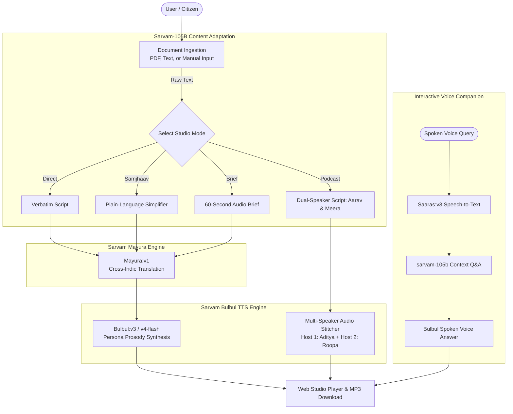

# 🎙️ VaaniSetu (वाणीसेतु) — Indic Audio Intelligence & Accessibility Studio

[](https://www.python.org/downloads/)
[](https://fastapi.tiangolo.com)
[](https://www.sarvam.ai)
[](https://opensource.org/licenses/MIT)

> **Empowering 1.4B+ citizens across literacy and language boundaries with expressive Indic audio narration, multi-speaker educational podcasts, and interactive voice companion experiences.**

---

## 🌟 Overview & Societal Impact

India is home to hundreds of millions of citizens who speak regional languages but encounter massive barriers consuming written text — from complex government welfare circulars and legal notices to school textbooks and healthcare advisories. Existing screen readers are monotonous, lack emotional Indic prosody, fail with code-mixed languages, and do not simplify bureaucratic jargon.

**VaaniSetu (वाणीसेतु)** is a full-stack, multimodal audio intelligence studio powered by **Sarvam AI**. It transforms dense written content into:
1. **Expressive Indic Audio Narration** with native prosody and synchronized sentence karaoke.
2. **"Samjhaav" (Citizen Plain-Language Simplifier):** Translating dense legal/bureaucratic circulars into warm, everyday colloquial language.
3. **"NotebookLM for Bharat" (Dual-Speaker Podcasts):** Converting articles and textbooks into a lively 2-host conversational podcast (**Aarav & Meera**).
4. **Interactive Voice & Text Companion:** Hands-free voice question-answering during playback powered by **Saaras (ASR)** and **sarvam-105b**.

---

## 🚀 Key Features

| Feature | Description | Sarvam Engine |
|---|---|---|
| **📖 Direct Narration Studio** | Converts text to natural audio across 11 Indic languages with customizable personas (*Storyteller, News Anchor, Educator, Conversational*) and pacing. | `Bulbul` (`bulbul:v3` / `v4-flash`) |
| **💡 Samjhaav (Citizen Simplifier)** | Automatically eliminates bureaucratic jargon, explaining rights, subsidies, and schemes in plain language. | `sarvam-105b-conversations` |
| **🎙️ NotebookLM for Bharat** | Synthesizes a complete 2-host conversational dialogue (**Host 1: Aarav** & **Host 2: Meera**) stitched into a single podcast MP3 with speech bubble visuals. | `sarvam-105b` + `Bulbul` Multi-Voice |
| **⚡ 60-Second Audio Briefs** | Compresses long articles into high-retention 140-word spoken audio bulletins. | `sarvam-105b` |
| **💬 Voice Q&A Companion** | Listeners can click the mic or type to ask questions about the text; receives an instant spoken voice explanation. | `Saaras` (ASR) + `sarvam-105b` |
| **📎 Multimodal Document Ingestion** | 1-click upload of PDFs, study notes, or government gazettes with automated text extraction and noise cleaning. | `pypdf` + Sarvam DocAI |
| **🎵 Real-Time Sentence Karaoke** | Visual transcript highlights sentences in real time as the audio plays, enhancing literacy and accessibility. | Custom HTML5 Sync Engine |

---

## 🏗️ System Architecture



---

## 🌐 Supported Indic Languages

| Language Code | Language Name | Native Script |
|---|---|---|
| `hi-IN` | Hindi | हिन्दी |
| `en-IN` | Indian English | English |
| `bn-IN` | Bengali | বাংলা |
| `ta-IN` | Tamil | தமிழ் |
| `te-IN` | Telugu | తెలుగు |
| `kn-IN` | Kannada | ಕನ್ನಡ |
| `ml-IN` | Malayalam | മലയാളം |
| `mr-IN` | Marathi | मराठी |
| `gu-IN` | Gujarati | ગુજરાતી |
| `pa-IN` | Punjabi | ਪੰਜਾਬੀ |
| `od-IN` | Odia | ଓଡ଼ିଆ |

---

## 💻 Quickstart & Local Setup

### 1. Clone & Navigate
```bash
git clone https://github.com/pandeyysurabhi/sarvam.git
cd sarvam
```

### 2. Configure Environment
Create a `.env` file in the project root:
```env
SARVAM_API_KEY=your_sarvam_api_key_here
```

### 3. Install Dependencies
```bash
pip install -r requirements.txt
```

### 4. Run the Studio Server
```bash
python -m uvicorn backend.app:app --reload
```
Open **`http://localhost:8000`** in your browser!

---

## 🧪 Running the Test Suites

The project includes automated integration test suites covering all Sarvam AI integrations:

```bash
# Phase 1: Bulbul TTS, Mayura Translation, Language ID
python test_phase1.py

# Phase 2: sarvam-105b Content Adaptation, Podcasts, PDF Extraction
python test_phase2.py

# Phase 3: Saaras Voice Recognition & Interactive Q&A Companion
python test_phase3.py
```

---

## 📡 API Reference

### 1. Unified Narration (`/api/narrate`)
```bash
curl -X POST http://localhost:8000/api/narrate \
  -H "Content-Type: application/json" \
  -d '{
    "text": "The Prime Minister announced a new digital scholarship scheme.",
    "target_language_code": "hi-IN",
    "persona": "news",
    "pace": 1.0
  }'
```

### 2. Dual-Speaker Podcast (`/api/podcast`)
```bash
curl -X POST http://localhost:8000/api/podcast \
  -H "Content-Type: application/json" \
  -d '{
    "text": "The benefits of rainwater harvesting in dry regions.",
    "target_language_code": "hi-IN"
  }'
```

### 3. Voice Companion Q&A (`/api/qa/voice`)
```bash
curl -X POST http://localhost:8000/api/qa/voice \
  -F "context_text=PM Kisan provides 6000 rupees per year in 3 installments." \
  -F "language_code=en-IN" \
  -F "file=@voice_query.wav"
```

---

## ☁️ 1-Click Deployment (Bonus Points)

### Option A: Render (Free Cloud Deployment)
1. Fork or push to your GitHub repository.
2. In [Render Dashboard](https://dashboard.render.com), click **New +** -> **Blueprint**.
3. Connect your repository (`render.yaml` is pre-configured).
4. Set the `SARVAM_API_KEY` secret environment variable.
5. Deploy! Render will give you a public `https://<your-app>.onrender.com` URL.

### Option B: Docker
```bash
docker build -t vaanisetu .
docker run -p 8000:8000 -e SARVAM_API_KEY="your_key" vaanisetu
```

### Option C: Docker Compose
```bash
docker compose up -d
```

---

## 📜 License
Distributed under the MIT License. Built with ❤️ for Bharat using [Sarvam AI](https://docs.sarvam.ai).
